# Full-Gradient Successor Feature Learning for Multi-Task Transfer in Reinforcement Learning

 **Paper:** [paper.pdf](paper.pdf)

 **Supplementary Material:** [supplementary.pdf](supplementary.pdf) (Appendices A–D: proofs of the lemmas, experimental details, additional results, algorithms)

This repository contains the implementation of **FG-SFRQL**. It extends **Successor Feature Representations (SFRQL)** by minimizing the full Bellman residual, differentiating through both the prediction and the bootstrap target. The repository also has the final results of the paper and the scripts that reproduce them.

We compare:
- **DQN**: standard Deep Q-Network, trained independently per task, without transfer;
- **FG-DQN**: full-gradient DQN, which backpropagates through the bootstrap target;
- **SFDQN**: semi-gradient successor features with Generalized Policy Improvement (GPI), updating the current task and the GPI-selected priors as in Alg. 1, following [Barreto et al.](https://arxiv.org/abs/1606.05312) and [Reinke et al.](https://arxiv.org/abs/2110.15701);
- **FG-SFDQN** (ours), which comes in three variants:
  - **Alg. 1 (sequential)**: tasks are learned one after another, with full-gradient updates of the current task and of the GPI-selected priors;
  - **Alg. 2 (randomized tasks)**: the task of each update is drawn from a distribution, so state-action-task triplets follow a stationary distribution, as the mean-field analysis requires;
  - **Alg. 3 (randomized + averaging)**: Alg. 2 with the Bellman target averaged over N next states.

  An averaged variant of Alg. 1 (N = 5, 10, 20) is also included.

The domains are:
- **Four Rooms**, a discrete grid world with object-based rewards;
- **slippery Four Rooms** and **slippery Reacher**: with probability p the action is replaced by a random one;
- **Reacher** (PyBullet), with discretized actions;
- **PointMaze** UMaze / Medium / Large (Gymnasium Robotics), with discretized actions.

---

## Installation

```bash
pip install -r requirements.txt
```

`requirements.txt` installs pybullet-gym from GitHub. To install it by hand instead:

```bash
pip install pybullet "gym<0.26"
git clone https://github.com/benelot/pybullet-gym.git
cd pybullet-gym && pip install -e .
```

---

## Repository layout

```
agents/                    DQN, FG-DQN, SFDQN, FG-SFDQN agents and the replay buffer
features/                  successor-feature networks (semi-gradient and full-gradient)
tasks/                     Four Rooms, Reacher and PointMaze tasks
utils/
configs/config.cfg         final Four Rooms config; every other config is built from it
train_parallel.py          trains the methods on a task sequence
evaluate_parallel.py       final evaluation of trained checkpoints
run_paper_experiments.py   all main experiments (5 domains x 3 seeds), evaluation and step-time benchmark
run_slippery.py            slippery domains (p = 0.2, 0.3), training and evaluation
benchmark_step_time.py     per-step training time
make_paper_figures.py      figures and numbers of the main experiments
make_slippery_figures.py   slippery domain figures
results/                   final results of the paper (no checkpoints)
figures/                   final figures of the paper (PDF; PNG copies in figures/png)
supplementary.pdf
```

---

## Reproducing the paper

Main experiments: Four Rooms, Reacher, PointMaze UMaze / Medium / Large, all methods, seeds 0–2, followed by the final evaluation and the step-time benchmark. The run is resumable.

```bash
python run_paper_experiments.py --root paper_runs --seeds 0,1,2 --max-parallel 10
python make_paper_figures.py --root paper_runs --out figures
```

Slippery Four Rooms and slippery Reacher:

```bash
python run_slippery.py --root slippery_runs --seeds 0,1,2 --max-parallel 11
python make_slippery_figures.py --root slippery_runs --out figures
python run_slippery.py --env reacher --root slippery_reacher --seeds 0,1,2 --max-parallel 14
python make_slippery_figures.py --env reacher --root slippery_reacher --out figures
```

To regenerate the figures from the included results:

```bash
python make_paper_figures.py --root results/paper_runs --out figures
python make_slippery_figures.py --root results/slippery_fourrooms --out figures
python make_slippery_figures.py --env reacher --root results/slippery_reacher --out figures
```

To train a single method on a single config:

```bash
python train_parallel.py --config configs/config.cfg --methods FG-SFDQN --trial-ids 0 --out fg_sfdqn.npz --weights-dir weights
python evaluate_parallel.py --config configs/config.cfg --weight-root weights --out-root eval --models FGSFDQN \
    --n-episodes 10 --n-eval-runs 1 --max-steps 100 --video-checkpoint none
```

Available methods: `DQN`, `FGDQN`, `SFDQN`, `FG-SFDQN` (Alg. 1), `AvgFGSFDQN`, `AvgFGSFDQN-N10` and `AvgFGSFDQN-N20` (averaged Alg. 1), `alg2` and `alg3`.

### Hyperparameters

| Parameter | Four Rooms | Reacher | PointMaze |
|---|---|---|---|
| Steps per task | 10,000 | 40,000 | 30,000 |
| Number of tasks | 6 | 4 | 8 |
| Exploration (ε) | 0.60 | 0.55 | 0.60 |
| Batch size | 512 | 512 | 512 |
| Replay buffer size | 200,000 | 200,000 | 200,000 |
| Discount (γ) | 0.95 | 0.95 | 0.95 |
| Episode horizon (T) | 200 | 200 | 200 |
| Learning rate | 0.001 | 0.001 | 0.001 |
| Reward-weight LR (α_w) | 0.5 | 0.5 | 0.5 |
| Averaging samples (N) | 5 (ablation: 5, 10, 20) | 5 (ablation: 5, 10, 20) | 5 (ablation: 5, 10, 20) |
| Seeds | 3 | 3 | 3 |

The slippery domains use p ∈ {0.2, 0.3}; slippery Four Rooms uses 6 tasks of 30,000 steps each and otherwise the Four Rooms settings, and slippery Reacher the Reacher settings. In Reacher, the averaged methods draw their N next states from the simulator by restoring its state. The configs used for every run are in `results/*/*/config.cfg`.

---

## Results

### Results layout

```
results/paper_runs/<exp>/config.cfg
results/paper_runs/<exp>/results/<method>_t<seed>.npz       training reward history
results/paper_runs/<exp>/eval/evaluation_summary.json       final evaluation of every method and seed
results/paper_runs/<exp>/diagnostics/<method>_trial_<seed>.json   Bellman residual and GPI tie rates
results/paper_runs/benchmark.json                            per-step time (pooled over 3 seeds)
results/paper_runs/benchmark/                                raw per-step times
results/slippery_fourrooms/p<p>/<method>_s<seed>.npz         training reward history
results/slippery_fourrooms/p<p>/eval_<method>_s<seed>/       final evaluation
results/slippery_reacher/p<p>/...                            the same for slippery Reacher
figures/results.json                                         every number of the paper's main results
```

All numbers below are mean ± std over 3 seeds.

### Total cumulative training reward

| Method | Four Rooms | Reacher | PM-UMaze | PM-Medium | PM-Large |
|---|---|---|---|---|---|
| DQN | 341 ± 18 | 64996 ± 7318 | 61325 ± 14063 | 65897 ± 5462 | 58929 ± 1300 |
| FG-DQN | 611 ± 80 | 63744 ± 5407 | 63323 ± 324 | 57534 ± 2743 | 46333 ± 2793 |
| SFDQN | 500 ± 36 | 84135 ± 6232 | 74735 ± 5828 | 67948 ± 3551 | 54621 ± 5360 |
| FG-SFDQN (Alg. 1) | **1365 ± 185** | **85328 ± 4935** | **84737 ± 2500** | **73746 ± 3927** | **61866 ± 1750** |
| FG-SFDQN (Alg. 2) | 990 ± 96 | 79616 ± 4551 | 80877 ± 4144 | 68050 ± 1248 | 51609 ± 3526 |
| FG-SFDQN (Alg. 3) | 1081 ± 26 | 78684 ± 6687 | 82588 ± 1349 | 67217 ± 3439 | 51631 ± 2033 |

### Final evaluation

These numbers are the mean return per episode, averaged over tasks. Each task is evaluated for 10 episodes, capped at 100 steps.

| Method | Four Rooms | Reacher | PM-UMaze | PM-Medium | PM-Large |
|---|---|---|---|---|---|
| DQN | 0.03 ± 0.04 | 33.92 ± 5.08 | 18.98 ± 3.41 | 10.87 ± 1.53 | 15.01 ± 2.04 |
| FG-DQN | 0.02 ± 0.03 | 39.43 ± 1.53 | 13.81 ± 2.83 | 11.05 ± 4.20 | 11.63 ± 5.58 |
| SFDQN | 0.41 ± 0.15 | 38.68 ± 11.55 | 23.82 ± 3.30 | 21.00 ± 2.23 | 19.54 ± 0.70 |
| FG-SFDQN (Alg. 1) | **3.38 ± 0.03** | **71.71 ± 5.70** | **29.54 ± 0.37** | **27.10 ± 1.25** | **27.24 ± 0.71** |
| FG-SFDQN (Alg. 2) | 2.92 ± 0.35 | 68.54 ± 4.85 | 27.82 ± 0.65 | 24.75 ± 0.39 | 20.12 ± 1.81 |
| FG-SFDQN (Alg. 3) | 3.20 ± 0.31 | 68.05 ± 5.46 | 28.54 ± 0.94 | 25.92 ± 1.81 | 22.02 ± 3.36 |

### Slippery Four Rooms

| Method | p = 0.2: training | p = 0.2: evaluation | p = 0.3: training | p = 0.3: evaluation |
|---|---|---|---|---|
| DQN | 942 ± 60 | 0.29 ± 0.18 | 793 ± 88 | 0.31 ± 0.29 |
| FG-DQN | 1,505 ± 39 | 0.00 ± 0.00 | 1,177 ± 68 | 0.37 ± 0.03 |
| SFDQN | 1,593 ± 218 | 0.41 ± 0.20 | 1,531 ± 55 | 0.54 ± 0.05 |
| FG-SFDQN (Alg. 1) | 3,410 ± 105 | 2.92 ± 0.10 | 2,580 ± 188 | 2.67 ± 0.07 |
| FG-SFDQN (Alg. 1), averaged N=5 | **4,043 ± 122** | **3.79 ± 0.16** | **3,303 ± 65** | **3.19 ± 0.19** |
| FG-SFDQN (Alg. 2) | 3,452 ± 44 | 3.17 ± 0.18 | 2,838 ± 96 | 2.86 ± 0.13 |
| FG-SFDQN (Alg. 3) | 3,866 ± 57 | 3.51 ± 0.07 | 3,256 ± 78 | 3.13 ± 0.26 |

### Slippery Reacher

| Method | p = 0.2: training | p = 0.2: evaluation | p = 0.3: training | p = 0.3: evaluation |
|---|---|---|---|---|
| DQN | 66,789 ± 4,291 | 32.7 ± 5.5 | 61,410 ± 4,035 | 34.7 ± 4.6 |
| FG-DQN | 58,239 ± 10,760 | 37.2 ± 2.9 | 55,988 ± 2,682 | 38.5 ± 3.9 |
| SFDQN | **82,470 ± 3,750** | 42.3 ± 10.6 | **76,853 ± 6,729** | 46.6 ± 3.3 |
| FG-SFDQN (Alg. 1) | 71,634 ± 1,072 | 57.5 ± 1.6 | 67,698 ± 561 | 52.6 ± 0.8 |
| FG-SFDQN (Alg. 1), averaged N=5 | 80,967 ± 4,219 | **69.3 ± 1.8** | 74,379 ± 2,362 | 61.7 ± 3.4 |
| FG-SFDQN (Alg. 2) | 63,949 ± 4,347 | 53.5 ± 1.4 | 63,241 ± 2,779 | 48.1 ± 5.1 |
| FG-SFDQN (Alg. 3) | 73,018 ± 3,223 | 68.1 ± 4.5 | 67,267 ± 1,077 | **63.0 ± 0.9** |

### Per-step training time

The benchmark ran on PointMaze-UMaze with 8 tasks and batch 512, on an RTX 4000 Ada GPU with an Intel Core i9-14900KS CPU. Each of 3 runs timed 1,500 steps after a 512-step warm-up, and the steps of all runs are pooled.

| Method | Mean (ms) | Median (ms) | Std (ms) |
|---|---|---|---|
| DQN | 1.05 | 1.04 | 0.05 |
| FG-DQN | 1.19 | 1.18 | 0.04 |
| SFDQN | 4.47 | 4.19 | 1.22 |
| FG-SFDQN (Alg. 1) | 4.34 | 2.67 | 2.62 |
| FG-SFDQN (Alg. 1, N = 5) | 5.11 | 3.85 | 2.83 |
| FG-SFDQN (Alg. 2) | 9.59 | 9.61 | 0.44 |
| FG-SFDQN (Alg. 3) | 10.12 | 10.12 | 0.46 |

### Figures

<p align="center">
  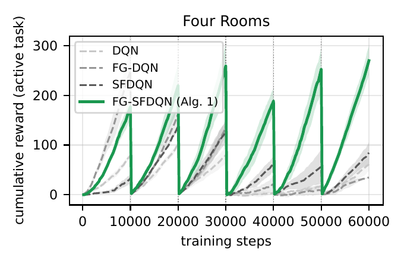
  <br>
  <em>Cumulative training reward on each task in Four Rooms (sequential methods, mean ± std over 3 seeds); dotted lines mark the task switches.</em>
</p>

<p align="center">
  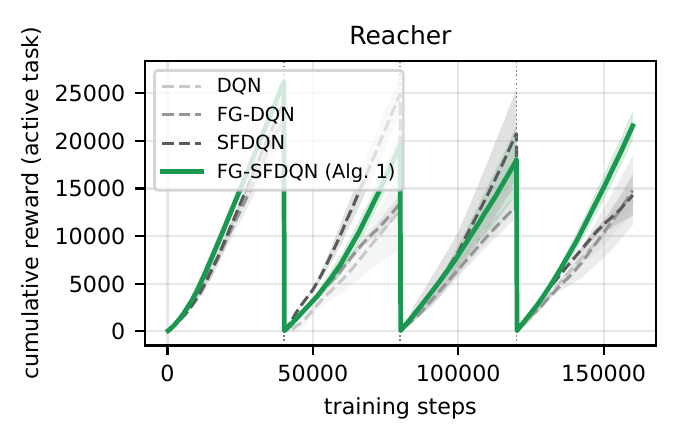
  <br>
  <em>Cumulative training reward on each task in Reacher (sequential methods, mean ± std over 3 seeds); dotted lines mark the task switches.</em>
</p>

<p align="center">
  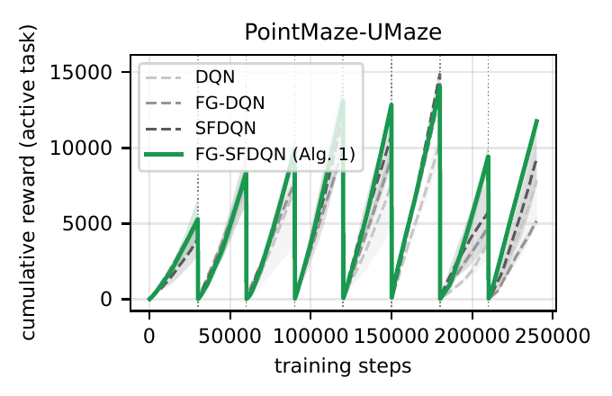
  <br>
  <em>Cumulative training reward on each task in PointMaze-UMaze (sequential methods, mean ± std over 3 seeds); dotted lines mark the task switches.</em>
</p>

<p align="center">
  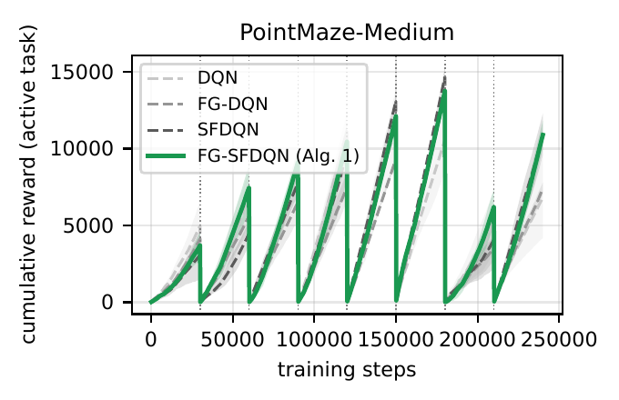
  <br>
  <em>Cumulative training reward on each task in PointMaze-Medium (sequential methods, mean ± std over 3 seeds); dotted lines mark the task switches.</em>
</p>

<p align="center">
  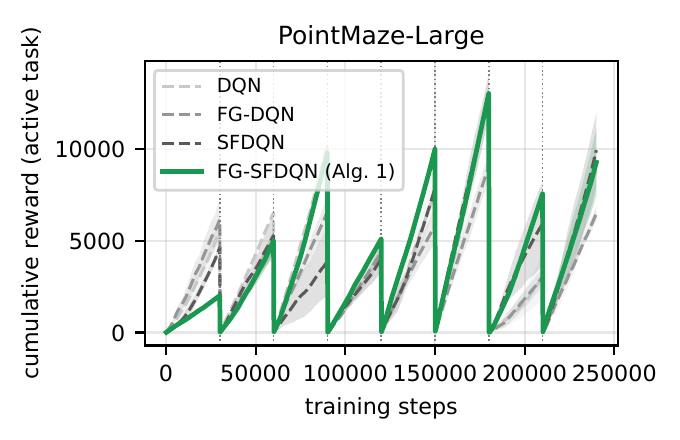
  <br>
  <em>Cumulative training reward on each task in PointMaze-Large (sequential methods, mean ± std over 3 seeds); dotted lines mark the task switches.</em>
</p>

<p align="center">
  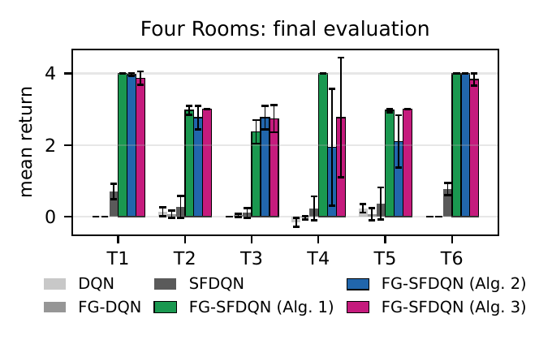
  <br>
  <em>Final evaluation per task in Four Rooms.</em>
</p>

<p align="center">
  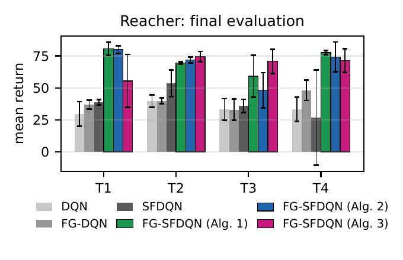
  <br>
  <em>Final evaluation per task in Reacher.</em>
</p>

<p align="center">
  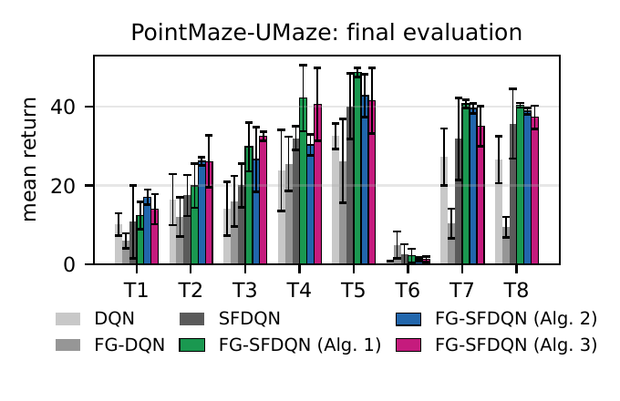
  <br>
  <em>Final evaluation per task in PointMaze-UMaze.</em>
</p>

<p align="center">
  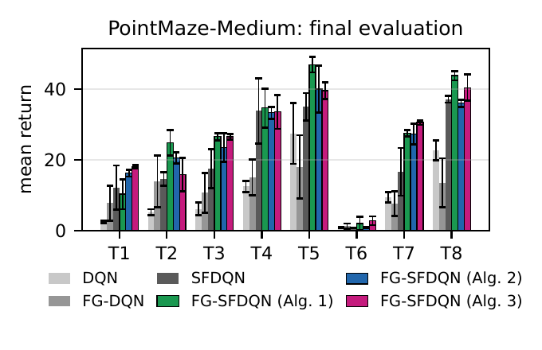
  <br>
  <em>Final evaluation per task in PointMaze-Medium.</em>
</p>

<p align="center">
  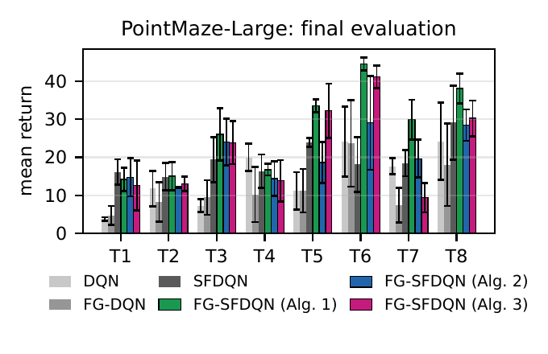
  <br>
  <em>Final evaluation per task in PointMaze-Large.</em>
</p>

<p align="center">
  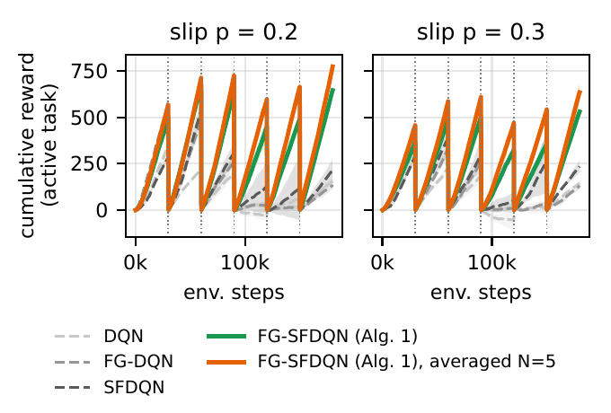
  <br>
  <em>Slippery Four Rooms (p = 0.2, 0.3): cumulative training reward on each task, sequential methods (mean ± std over 3 seeds); dotted lines mark the task switches.</em>
</p>

<p align="center">
  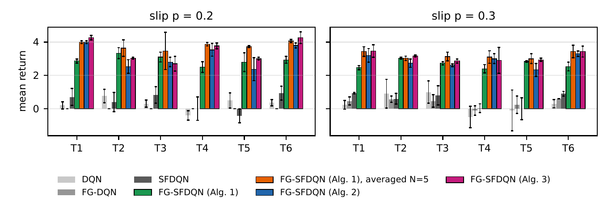
  <br>
  <em>Slippery Four Rooms (p = 0.2, 0.3): final evaluation per task, all methods (mean ± std over 3 seeds).</em>
</p>

<p align="center">
  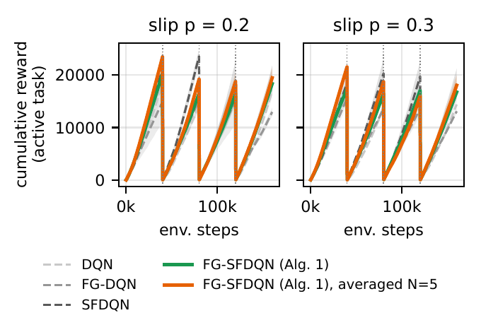
  <br>
  <em>Slippery Reacher (p = 0.2, 0.3): cumulative training reward on each task, sequential methods (mean ± std over 3 seeds); dotted lines mark the task switches.</em>
</p>

<p align="center">
  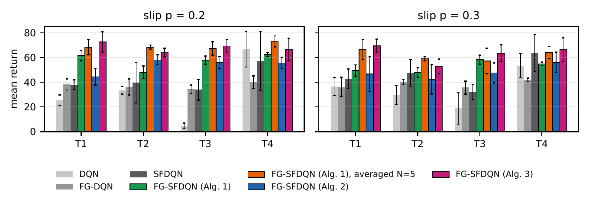
  <br>
  <em>Slippery Reacher (p = 0.2, 0.3): final evaluation per task, all methods (mean ± std over 3 seeds).</em>
</p>

<p align="center">
  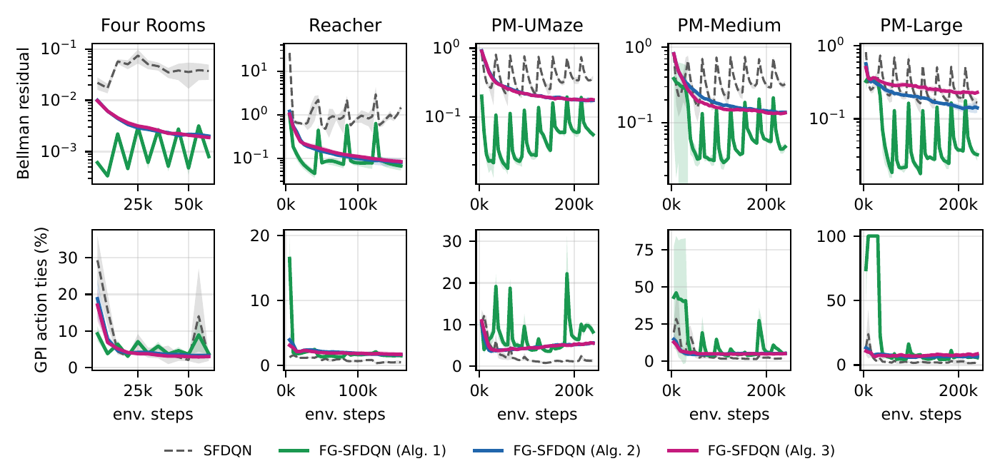
  <br>
  <em>Squared SF Bellman residual of the current task and rate of near-ties in the GPI action.</em>
</p>

---

## Citation
```bibtex
@misc{shrirao2026fullgradientsuccessorfeaturerepresentations,
      title={Full-Gradient Successor Feature Learning for Multi-Task Transfer in Reinforcement Learning},
      author={Ritish Shrirao and Aditya Priyadarshi and Raghuram Bharadwaj Diddigi},
      year={2026},
      eprint={2604.00686},
      archivePrefix={arXiv},
      primaryClass={cs.LG},
      url={https://arxiv.org/abs/2604.00686},
}
```
